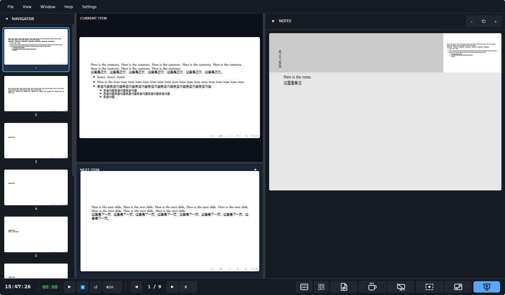

# PDF Presentation Tool

[简体中文](README.zh-CN.md) | English

This is a Windows 11 x64 portable PDF (Beamer) presentation tool developed as a secondary development based on [DamianoP/PDF_Presentation_Tool](https://github.com/DamianoP/PDF_Presentation_Tool).

This project is intended for presentation scenarios involving a "laptop main screen + external monitor or projector". The program can be run directly from a USB drive and does not require Node.js, a browser, or a network connection to be installed. The current interface supports Simplified Chinese and English, and uses Simplified Chinese by default.

> Note: This project relies heavily on AI for development. Although I have not found any problems in my own use so far, please evaluate the risks yourself.
> * [pympress](https://github.com/Cimbali/pympress) is a powerful and comprehensive open-source PDF presentation tool, but in my actual use it frequently stuttered.
> * [dspdfviewer](https://github.com/projekter/dspdfviewer) can present smoothly, but does not support features such as a laser pointer.
> * [PDF-Presentation-Tool](https://github.com/DamianoP/PDF_Presentation_Tool) can present smoothly and supports features such as a laser pointer, but it requires Node.js to be installed, and it must be connected to the Internet the first time it is used, making it inconvenient to use.
> 
> For the above reasons, I decided to develop a portable version as a secondary development to make it convenient to use during presentations. The main features are as follows.

## UI display

## Main Features

- Dual-window presentation: the presenter window and the audience window are separated
- Selection of external monitor and projector
- Automatic detection of Beamer dual-width PDFs; please use the command `\setbeameroption{show notes on second screen=right}` in Beamer
- Presenter notes preview: displays the current page, the next page, and notes (Notes)
- Laser pointer, spotlight, whiteboard annotation, and eraser
- Black screen, timer, break countdown

**The following are new features after the secondary development:**
- Both the current page and the presentation window support PDF internal link jumps
- The layout of the current page, next page, thumbnails, and notes panel can be adjusted
- Fully offline operation; PDF.js and Worker use local files
- Portable: it can be placed directly on a USB drive. When at an unfamiliar presentation venue or using someone else's computer, you can plug in the USB drive and use it directly
- Language switching: Simplified Chinese / English

## Instructions

### Run the portable version directly

1. Copy `PDF-Presentation-Tool-Portable-1.0.0-x64.exe` to a USB drive.
2. Double-click to run. No need to install Node.js, a browser, or any other runtime environment.
3. On the initial screen, click `📄 Choose File` to select a PDF file; you can also drag a PDF into the selection area.
4. After the PDF is loaded, enter the presenter interface.
5. Click Start/Stop Presentation in the lower right corner, and select the audience monitor or projector.
6. After moving the audience window to the target screen, press `F` in the audience window to enter or exit native fullscreen.
7. Press `Esc` in the audience window to end the presentation and close the audience window.

## Common Shortcuts

| Key                                     | Function                              |
| --------------------------------------- | ------------------------------------- |
| `Right` / `Down` / `Space` / `PageDown` | Next page                             |
| `Left` / `Up` / `PageUp`                | Previous page                         |
| `Home`                                  | First page                            |
| `End`                                   | Last page                             |
| `B` or `.`                              | Black screen                          |
| `F`                                     | Toggle presentation window fullscreen |
| `L`                                     | Laser pointer                         |
| `S`                                     | Spotlight                             |
| `Z`                                     | Magnifier                             |
| `P`                                     | Audience progress bar                 |
| `D`                                     | Whiteboard annotation                 |
| `E`                                     | Eraser                                |
| `C`                                     | Clear annotations                     |
| `1`–`5`                                 | Switch annotation color               |
| `+` / `-`                               | Adjust annotation line width          |

## Runtime Architecture

    Presenter window index.html  ── BroadcastChannel / postMessage ── Audience window presentation.html
             │
             └── Local Node.js + Express + WebSocket service

PDF rendering is completed locally through PDF.js. The Electron main process is responsible for the local server, independent windows, monitor selection, and native fullscreen.

## Project Structure

    ├── data/                         # Frontend pages, styles, local resources, and JavaScript
    │   ├── index.html                # Presenter window
    │   ├── presentation.html         # Audience presentation window
    │   ├── css/main.css              # Main styles
    │   ├── js/                       # Application, PDF rendering, and window communication logic
    │   └── public/vendor/pdfjs/      # Local PDF.js and Worker
    ├── electron/                     # Electron main process and preload
    ├── scripts/                      # Offline checks and Electron smoke tests
    ├── Doc/                          # Project architecture documentation
    ├── server.js                     # Local Express/WebSocket service
    ├── package.json                  # Dependencies and build scripts
    ├── package-lock.json             # Pinned dependency versions
    └── vite.config.js                # Vite configuration

## Offline and Privacy

- PDF files are processed locally and are not uploaded to a server.
- PDF.js, Worker, application pages, and Service Worker all use local resources.
- At runtime, there is no dependence on CDNs, Google Fonts, or first-time online downloads.
- This project does not modify the PDF files selected by the user.

## Development and Build

The development environment requires Node.js 20–24 and Windows 11 x64.

    npm install
    npm run build
    npm run check:offline

Generate the Windows portable version:

    $workspace = (Get-Location).Path
    $env:ELECTRON_CACHE = Join-Path $workspace '.electron-cache'
    $env:ELECTRON_BUILDER_CACHE = Join-Path $workspace '.electron-builder-cache'
    $env:TEMP = Join-Path $workspace '.tmp'
    $env:TMP = Join-Path $workspace '.tmp'
    npm run dist:portable

## Open Source and License

This project is a secondary development based on [DamianoP/PDF_Presentation_Tool](https://github.com/DamianoP/PDF_Presentation_Tool). When publishing and modifying it, please retain the copyright, license, and third-party dependency notices of the original project.

The `LICENSE` in the project root directory is the AGPL-3.0 license. The bundled PDF.js files come with their license file, located at `data/public/vendor/pdfjs/3.2.146/LICENSE.txt`.
